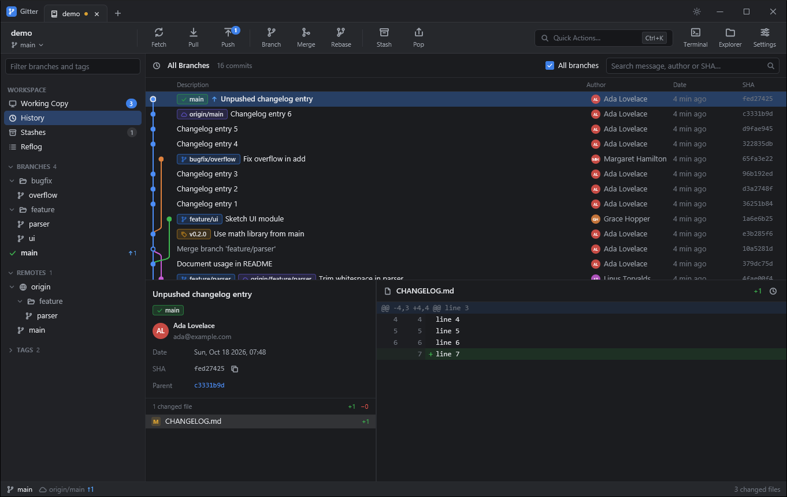
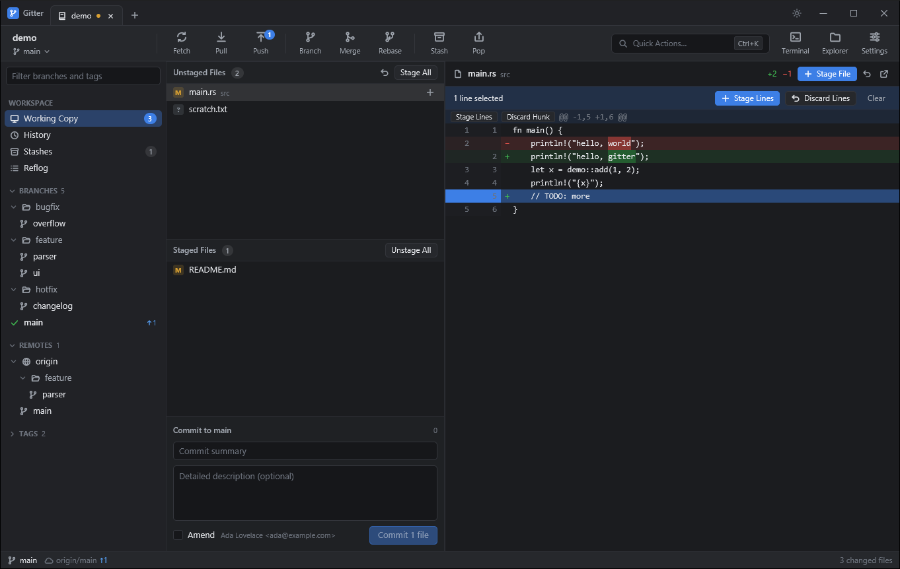
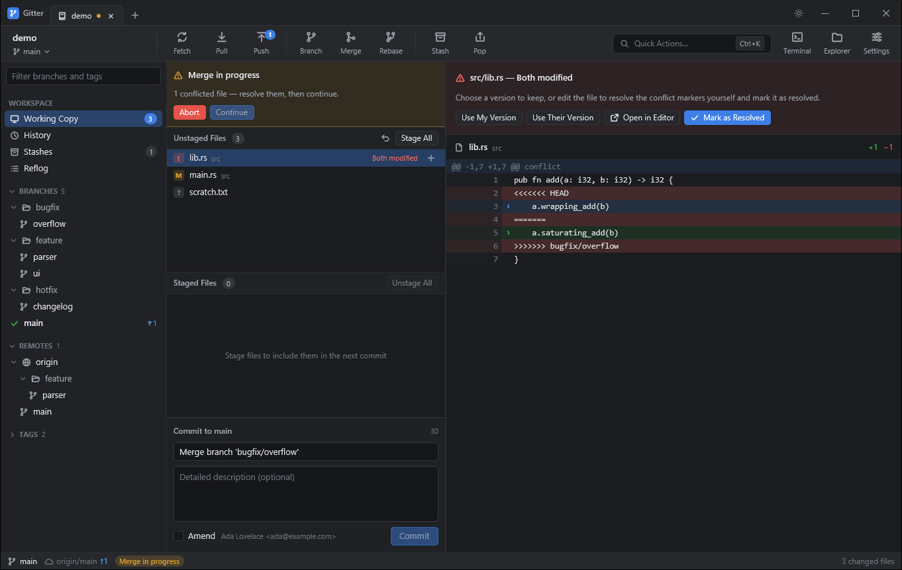

# Gitter

A fast, native, cross-platform Git client in the spirit of [Tower](https://www.git-tower.com),
written in Rust on top of [GPUI](https://gpui.rs), the GPU-accelerated UI framework that powers the Zed editor.



## Features

**Working copy**
- Unstaged / staged file lists with status badges, rename detection and conflict markers
- Stage and unstage whole files (button, double-click, <kbd>Space</kbd>/<kbd>Enter</kbd>), **individual hunks**, or **individual lines** (click, <kbd>Shift</kbd>-click for ranges)
- Discard files, hunks or selected lines (with confirmation); untracked files are deleted
- Commit composer with summary/description, length hints, amend (pre-fills the last message), <kbd>Ctrl/⌘</kbd>+<kbd>Enter</kbd> to commit
- Ignore files, extensions or folders straight from the context menu (`.gitignore`)

**History**
- Commit graph with colored lanes, merge curves and branch/tag/remote badges
- "All branches" or per-branch / per-tag / per-remote-branch history; file history
- Incremental loading (tested with 30,000 commits and 850+ branches)
- Search by message, author or SHA
- Commit details: message, author avatar, dates, parents (clickable), changed files with line stats, and the diff
- Unpushed commits are marked
- Context menu: check out, create branch/tag, cherry-pick, revert, reset (soft/mixed/hard), rebase onto,
  **edit message**, **squash into parent**, **move up/down**, **drop**, copy SHA/message

**Branches, remotes, tags, stashes**
- Sidebar tree with folders (`feature/…`), ahead/behind counts, filter box, and a virtualized list for huge repos
- Check out (double-click), create, rename, delete, track/untrack, merge (fast-forward, `--no-ff`, `--squash`), rebase
- **Drag and drop**: drop a branch on the current branch to merge or rebase, or on a remote to push it
- Fetch, pull (merge or rebase, with autostash), push (pick remote/branch, set upstream, tags, force-with-lease) with live progress
- Remotes: add, edit, rename, remove, fetch, open in browser
- Tags: create (lightweight or annotated, optionally pushed), push, delete locally/remotely
- Stashes: save (with message, untracked files, keep index), apply, pop, delete, and browse their contents

**Conflicts and in-progress operations**
- Banner for merge/rebase/cherry-pick/revert in progress with Abort / Skip / Continue
- Conflict view highlights "ours" and "theirs"; resolve with either side or mark as resolved

**Undo** (<kbd>Ctrl/⌘</kbd>+<kbd>Z</kbd>, or the Undo link on toasts)
- Commit and amend (the message goes back into the composer), checkout, branch create/delete, tag create/delete,
  stage/unstage, stash, and anything that moves HEAD (merge, rebase, reset, pull, cherry-pick, revert, history rewrites)

**Everything else**
- Tabs for multiple repositories, restored on launch; repository manager with recents, pinning, open/clone/init
- Quick Actions palette (<kbd>Ctrl/⌘</kbd>+<kbd>K</kbd>) with fuzzy search over commands and branches
- Reflog browser, blame view, submodules (open, update)
- Auto-refresh via a file system watcher and on window focus; optional background auto-fetch
- Inline word-level diff highlighting
- Dark and light themes, adjustable font size, settings window (global Git identity, pull strategy, diff context)
- Custom title bar with native window controls on Windows, traffic lights on macOS

| | |
|---|---|
|  |  |

## How it works

Gitter drives the `git` command-line tool for everything, the same approach Tower takes. That means it honours your
Git config, hooks, credential helpers, GPG signing, LFS and SSH setup out of the box, and supports every Git feature
the CLI does. Read operations use machine-readable formats (`status --porcelain=v2 -z`, `for-each-ref`, custom `log`
formats) and run with `GIT_OPTIONAL_LOCKS=0` so they never fight other Git processes. Line staging builds a partial patch
and applies it with `git apply --cached`; history rewriting runs a scripted `git rebase -i`.

```
src/
  git/         Git backend: command runner, parsers, commit-graph lanes, partial patches (unit + integration tests)
  repo/        The repository view: toolbar, sidebar, history, working copy, diff, dialogs, palette, undo…
  ui/          Widgets: text input (IME, selection, undo, soft wrap), buttons, menus, icons
  workspace.rs Window root: title bar, tabs, repository manager, clone
  settings*.rs Persistent settings and the settings window
```

## Building

You need a recent stable Rust toolchain and `git` on your `PATH`.

```bash
cargo run --release
```

Open a repository directly with `cargo run --release -- path/to/repo`.

Platform requirements for GPUI:

- **Windows**: the MSVC toolchain (Visual Studio Build Tools with "Desktop development with C++" and the Windows SDK).
- **macOS**: Xcode (GPUI compiles Metal shaders with `xcrun`).
- **Linux**: Vulkan drivers plus development packages, for example on Debian/Ubuntu:
  `sudo apt install libxkbcommon-x11-dev libwayland-dev libvulkan-dev libfontconfig-dev libx11-xcb-dev`

Run the tests with `cargo test`.

## Keyboard shortcuts

<kbd>Ctrl</kbd> on Windows/Linux, <kbd>⌘</kbd> on macOS.

| Shortcut | Action |
|---|---|
| Ctrl+K / Ctrl+Shift+A | Quick Actions |
| Ctrl+1 / 2 / 3 / 4 | Working Copy / History / Stashes / Reflog |
| Ctrl+Enter | Commit |
| Ctrl+Z | Undo the last operation |
| Ctrl+Shift+F / L / P | Fetch / Pull / Push |
| Ctrl+B | New branch |
| Ctrl+Shift+M | Merge a branch |
| Ctrl+Shift+S | Stash changes |
| Ctrl+F | Search commits |
| Ctrl+R / F5 | Refresh |
| Ctrl+Shift+T | Open a terminal in the repository |
| Ctrl+O / Ctrl+Shift+O | Open / clone a repository |
| Ctrl+T / Ctrl+W | Repositories tab / close tab |
| Ctrl+Tab / Ctrl+Shift+Tab | Next / previous tab |
| Ctrl+, | Settings |
| ↑ ↓ | Move through lists |
| Space / Enter | Stage or unstage the selected file |
| Delete | Discard the selected file's changes |

## Known limitations

- SSH keys protected by a passphrase need an SSH agent; Gitter can't show an interactive SSH prompt.
  HTTPS credentials work through your configured credential helper (e.g. Git Credential Manager).
- No hosting-service integration (pull requests, issues) yet.
- History rewriting from the context menu works on linear history only (not across merge commits).
- Built and tested on Windows so far. The code uses GPUI's cross-platform APIs and has macOS/Linux branches
  (title bar, terminal launching, window controls), but it hasn't been compiled or run on those systems yet.
